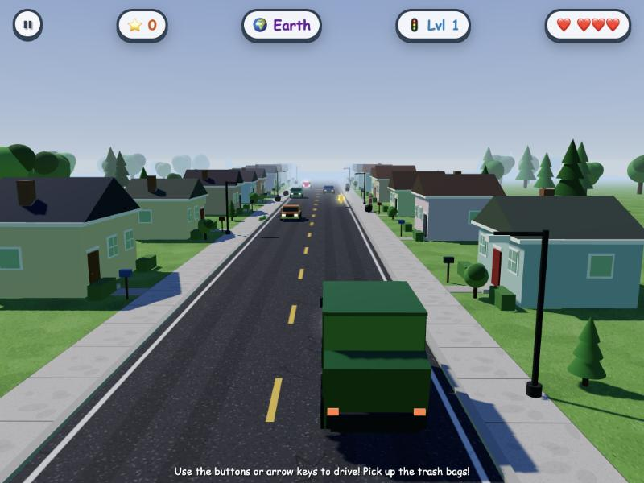
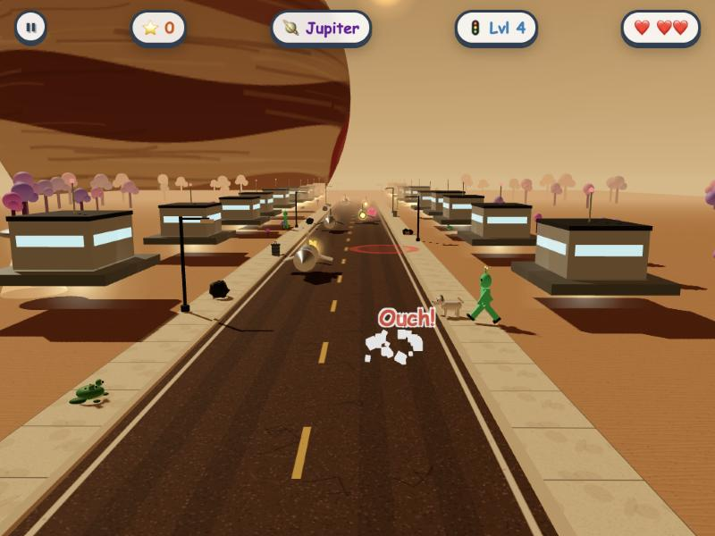

# Catch the Garbage!

A browser-based driving game built for young kids. Steer a trash truck through the neighborhood, pick up garbage from people's houses, and dodge cars, pedestrians, dogs, chickens, frogs, aliens, UFOs, and falling asteroids. Each level takes you to a new planet — from Earth to the Moon, Mars, Jupiter, Saturn (with rings!), and beyond.

The whole game is a single self-contained HTML file with no dependencies and no build step.

## Play Now

**[https://engfranco.github.io/catch-the-garbage/](https://engfranco.github.io/catch-the-garbage/)**

Just open the link in any modern browser — desktop, tablet, or phone — and start playing. Nothing to install.


## New: 3D Version

**[https://engfranco.github.io/catch-the-garbage/v2/](https://engfranco.github.io/catch-the-garbage/v2/)**

The same game, rebuilt as a 3D neighborhood seen from a camera behind the truck. It keeps every pickup, hazard, planet and control from the classic version and adds:

- A real 3D street with houses, trees, street lamps, mailboxes and hedges that stream past
- Real-time lighting and shadows, a sky dome, fog and image-based reflections on the vehicles
- Eight planets with their own skies, ground textures, buildings (domes, rock huts, floating platforms, igloos), vehicles (cars, rovers, hovering spaceships) and inhabitants
- Jupiter filling the sky, Earth seen from the Moon, Saturn's rings arching overhead, and night-time planets where the truck's headlights and the windows light up
- Procedurally generated textures for asphalt, sidewalks, grass, regolith, dust, sand and ice (no image files)
- Tap-to-steer on touch screens: tap or drag where you want the truck to go, or use the on-screen buttons
- Heart thieves: raccoons (1 ❤️), skunks (2 ❤️) and trash monsters (3 ❤️) sneak up on the truck, grab hearts and run off down the road with them floating over their heads. Push forward and catch them to get the hearts back with bonus points; if they get away, the hearts are gone. Thieves never take your last heart.
- Three difficulty routes chosen on the start screen and remembered between sessions:
  - 🌱 **Sunday Drive** for little kids: slow, five lives, gentle traffic, long safety time after a bump
  - 🚛 **Regular Route**: the classic balance
  - 🔥 **Rush Hour**: fast traffic, more hazards, no mercy
  
  Each route keeps its own high score.

The 3D version lives in the `v2/` folder and uses [Three.js](https://threejs.org/) (r185, bundled in `v2/lib/`, MIT licensed). There is still no build step. Because it is written as JavaScript modules, it has to be served over `http(s)://` (GitHub Pages or the local server below); double-clicking `v2/index.html` will not work in most browsers.

Tips: add `?level=N` to the URL to start on a later planet (`v2/?level=5` starts on Saturn), or `?mode=easy|medium|hard` to pre-select a route, e.g. `v2/?mode=easy` for a link you can hand straight to a young player.





## Features

- Top-down driving gameplay tuned for very young players
- Eight planets to visit (Earth, Moon, Mars, Jupiter, Saturn, Uranus, Neptune, Pluto), each with its own sky, scenery, vehicles, and inhabitants
- Pickups: trash bags (+10), stars (+50), heart power-ups (+1 life, max 5)
- Hazards: cars, pedestrians, dogs, chickens, frogs (hopping in classic Frogger style), aliens, UFOs, and falling asteroids with explosion zones
- Pause button, on-screen pause overlay, P/Esc keyboard shortcut, and auto-pause when the tab loses focus
- On-screen touch controls that auto-show on tablets and phones
- Keyboard controls (arrow keys or WASD) for desktop
- High score saved between sessions via localStorage
- iOS PWA-ready: add to the home screen and play fullscreen with no Safari chrome

## How to Play

- Move with the arrow keys (or tap the on-screen buttons on a tablet)
- Drive over trash bags to pick them up
- Stars give big bonus points; hearts restore a life
- Avoid everything else — three hits and the game ends
- Every ~22 seconds, a level transition takes you to a new planet

## Adding to an iPad's Home Screen

For the best experience on an iPad, install it as a fullscreen home-screen app:

1. Open [https://engfranco.github.io/catch-the-garbage/](https://engfranco.github.io/catch-the-garbage/) in Safari on your iPad.
2. Tap the **Share** button (the square with the up-arrow).
3. Scroll down and tap **Add to Home Screen**.
4. Confirm the name. A trash-truck icon appears on the home screen.

Tapping that icon launches the game fullscreen with no Safari address bar — it feels just like a real app, and it works whether you're at home or on the go.

## Running It Locally

You don't need to clone the repo to play, but you might want a local copy for offline play, development, or hosting on your own server.

### Quick local play

Clone or download the repo and double-click `index.html` to open it in your default browser. That works for desktop play.

For iPad "Add to Home Screen" using a local copy, you'll need to serve the file over `http(s)://` instead of `file://` (iOS only allows Add to Home Screen for real web URLs).

### macOS (one-click local server)

1. Make sure your iPad and Mac are on the same Wi-Fi network.
2. Double-click `start-ipad-server.command` in Finder.

   The first time you run it, macOS may warn that it's from an unidentified developer. Right-click the file, choose **Open**, then confirm.

3. A Terminal window opens and prints a URL like `http://192.168.1.42:8000/`.
4. Open that URL in Safari on your iPad (add `/v2/` at the end for the 3D version). Tap **Share** → **Add to Home Screen**.

Leave the Terminal window open while playing. Closing it stops the server.

### Windows

```
python -m http.server 8000
```

Find your PC's IP via `ipconfig`, then visit `http://YOUR-IP:8000/` from the iPad.

### Linux

```
python3 -m http.server 8000
```

Find your IP with `hostname -I`, then visit `http://YOUR-IP:8000/` from any device on your network.

## Hosting Your Own Copy

This repo is set up to publish via GitHub Pages — fork it, enable Pages in **Settings → Pages → Deploy from a branch → main**, and you'll have your own playable URL at `https://your-username.github.io/your-repo-name/`.

Other free hosts that work well for a single-page game:

- **tiiny.host** — drag and drop the folder, no account required
- **Netlify Drop** — drag the folder onto https://app.netlify.com/drop

## Browser Support

Tested in recent versions of Safari, Chrome, Firefox, and Edge on both desktop and tablet. The game uses standard HTML5 Canvas, the Web Audio API, and localStorage. There is no build step or package manager.

## Project Structure

```
index.html                   The classic 2D game (single self-contained file)
v2/                          The 3D version
  index.html                 Page, styles and UI overlays
  src/main.js                Game loop, input, spawning, collisions, HUD
  src/world.js               Sky, lights, ground, recycling scenery
  src/models.js              Procedural 3D models (truck, cars, people, animals, houses…)
  src/textures.js            Procedurally generated textures
  src/config.js              World layout and the eight planet definitions
  src/audio.js               Procedural sound effects
  lib/                       Three.js r185 (vendored, MIT)
start-ipad-server.command    macOS one-click local server launcher
screenshots/                 Screenshots used in this README
README.md                    This file
```

## Tech Notes

- Pure HTML, CSS, and vanilla JavaScript. No frameworks, no build step.
- The classic game renders on a single 2D canvas, scaled to the device pixel ratio.
- The 3D version renders with WebGL through Three.js: shadow-mapped sunlight, a gradient sky dome, fog, and a small environment map for reflections. Scenery is built from a handful of shared unit geometries and merged per material to keep draw calls low on tablets.
- Audio is generated procedurally with the Web Audio API (no sound files).
- iOS-specific meta tags enable the fullscreen home-screen experience.
- High scores persist via `localStorage`.

## License

Released under the [MIT License](LICENSE). You're free to use, modify, share, and remix the game — just keep the copyright notice in any copies or substantial portions you distribute.

## Contributing

Pull requests welcome — bug fixes, new planets, new obstacles, accessibility improvements, anything that makes the game more fun for kids.
