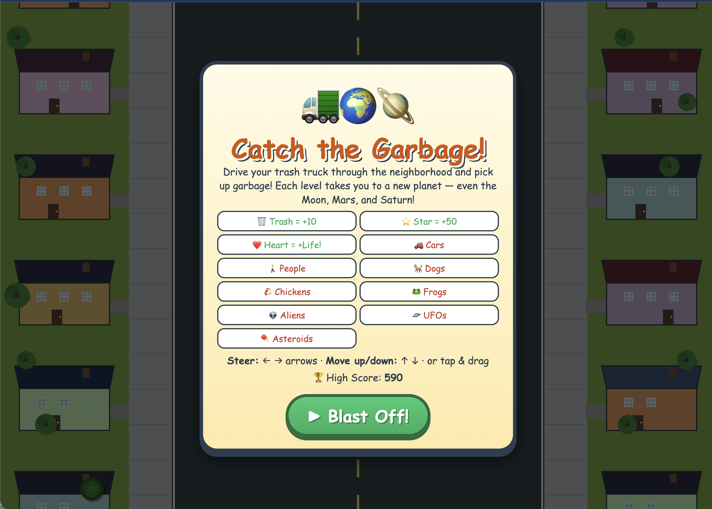
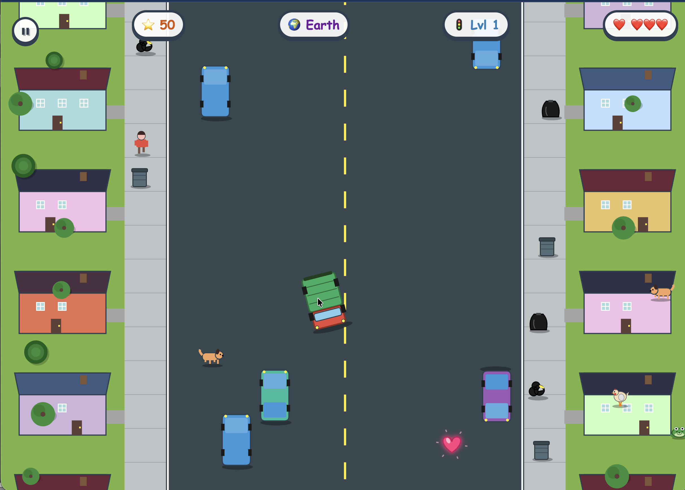

# Catch the Garbage!

A browser-based driving game built for young kids. Steer a trash truck through the neighborhood, pick up garbage from people's houses, and dodge cars, pedestrians, dogs, chickens, frogs, aliens, UFOs, and falling asteroids. Each level takes you to a new planet — from Earth to the Moon, Mars, Jupiter, Saturn (with rings!), and beyond.

The whole game is a single self-contained HTML file with no dependencies and no build step.





## Features

- Top-down driving gameplay tuned for very young players
- Eight planets to visit (Earth, Moon, Mars, Jupiter, Saturn, Uranus, Neptune, Pluto), each with its own sky, scenery, vehicles, and inhabitants
- Pickups: trash bags (+10), stars (+50), heart power-ups (+1 life, max 5)
- Hazards: cars, pedestrians, dogs, chickens, frogs (hopping in classic Frogger style), aliens, UFOs, and falling asteroids with explosion zones
- Pause button, on-screen pause overlay, P/Esc keyboard shortcut, and auto-pause when the tab loses focus
- On-screen touch controls that auto-show on tablets and phones
- Keyboard controls (arrow keys or WASD) for desktop
- High score saved between sessions via localStorage
- iOS PWA-ready: add to the home screen and play fullscreen with no Safari chrome

## How to Play

- Move with the arrow keys (or tap the on-screen buttons on a tablet)
- Drive over trash bags to pick them up
- Stars give big bonus points; hearts restore a life
- Avoid everything else — three hits and the game ends
- Every ~22 seconds, a level transition takes you to a new planet

## Running at Home

The simplest way to try the game is to open `index.html` directly in any modern browser — just double-click the file and it loads in your default browser. That works fine for desktop play.

For tablet play (especially iPad with the "Add to Home Screen" feature), you'll need a tiny local web server, because iOS only offers Add to Home Screen for real `http(s)://` URLs and not for files opened from the Files app.

### macOS (one-click)

1. Clone or download this repo to your Mac.
2. Make sure your iPad and Mac are on the same Wi-Fi network.
3. Double-click `start-ipad-server.command` in Finder.

   The first time you run it, macOS may warn that it's from an unidentified developer. Right-click the file, choose **Open**, then confirm. After that, double-clicking works normally.

4. A Terminal window opens and prints a URL like `http://192.168.1.42:8000/`.
5. Open that URL in Safari on your iPad.
6. Tap the **Share** button → **Add to Home Screen** → confirm. The game now has its own icon on the home screen.

Leave the Terminal window open while playing. Closing it stops the server.

### Windows

1. Clone or download this repo.
2. Open PowerShell or Command Prompt in the project folder.
3. Run:
   ```
   python -m http.server 8000
   ```
   (If that fails, try `py -m http.server 8000`. You may need to install Python from python.org if you don't have it.)
4. Find your PC's local IP: in PowerShell run `ipconfig` and look for the IPv4 address of your active adapter.
5. On your iPad, open Safari and visit `http://YOUR-IP:8000/`.
6. Share → Add to Home Screen.

### Linux

```
cd path/to/Catch-the-garbage
python3 -m http.server 8000
```

Find your IP with `hostname -I` (or `ip addr`), then visit `http://YOUR-IP:8000/` from any device on your network.

## Hosting It Online

If you'd like the game to work from anywhere — not just your home Wi-Fi — host the files somewhere with a real public URL. Free options that work well for a single-page game:

- **GitHub Pages** — Push this repo to GitHub, enable Pages in the repo's Settings → Pages, and the game will be served from `https://your-username.github.io/your-repo-name/`. Because the file is named `index.html`, the URL ends cleanly without a filename.
- **tiiny.host** — Drag and drop the folder at https://tiiny.host, no account required, get an instant URL.
- **Netlify Drop** — Drag the project folder onto https://app.netlify.com/drop. Free with a Netlify account.

Once it's online via `https://`, the iOS Add to Home Screen flow works exactly the same way and the home-screen icon will continue to load even when your Mac is off.

## Browser Support

Tested in recent versions of Safari, Chrome, Firefox, and Edge on both desktop and tablet. The game uses standard HTML5 Canvas, the Web Audio API, and localStorage. There is no build step or package manager.

## Project Structure

```
index.html                   The game (single self-contained file)
start-ipad-server.command    macOS one-click local server launcher
screenshots/                 Screenshots used in this README
README.md                    This file
```

## Tech Notes

- Pure HTML, CSS, and vanilla JavaScript. No frameworks, no build step.
- Rendering is done on a single 2D canvas, scaled to the device pixel ratio.
- Audio is generated procedurally with the Web Audio API (no sound files).
- iOS-specific meta tags enable the fullscreen home-screen experience.
- High scores persist via `localStorage`.

## License

This project is open source. Choose a license that fits your goals (MIT is a common, permissive default) and add a `LICENSE` file to the repo.

## Contributing

Pull requests welcome — bug fixes, new planets, new obstacles, accessibility improvements, anything that makes the game more fun for kids.
